# Artifact management with Nexus Repository Manager

This folder turns Nexus Repository Manager into the single place where Buy02 stores,
versions and serves its build artifacts: the Maven jars of the six Spring Boot services
and the Docker images of the whole platform. Every dependency the build needs is also
downloaded through Nexus.

```
                         ┌──────────────────────── Nexus (user "nexus", uid 200) ────────────────────────┐
 developer / Jenkins     │                                                                               │
 mvn -s settings.xml ───▶│ :8081 buy02-maven-group ─┬─ buy02-releases      (hosted, immutable)           │
   download / deploy     │                          ├─ buy02-snapshots     (hosted, timestamped builds)  │
                         │                          └─ maven-central-proxy ─────────────▶ Maven Central  │
 docker push ───────────▶│ :8082 buy02-docker-hosted                                                    │
 docker pull ───────────▶│ :8083 buy02-docker-group ─┬─ buy02-docker-hosted                              │
                         │                           └─ dockerhub-proxy ──────────────────▶ Docker Hub   │
                         └───────────────────────────────────────────────────────────────────────────────┘
```

| File | Purpose |
| --- | --- |
| [`compose.yml`](compose.yml) | Runs Nexus 3.98.1 in Docker as the non-root `nexus` user |
| [`install-native.sh`](install-native.sh) | Alternative: installs Nexus on a Linux host as a systemd service running as `nexus` |
| [`provision.sh`](provision.sh) | Creates the blob stores and the Maven/Docker hosted, proxy and group repositories |
| [`security.sh`](security.sh) | Creates the roles, the content selector and the users (RBAC) |
| [`maven/settings.xml`](maven/settings.xml) | Maven mirror and credentials: resolve and publish through Nexus only |
| [`release.sh`](release.sh) | Cuts a release: version, tag, deploy to `buy02-releases`, next snapshot |
| [`docker-publish.sh`](docker-publish.sh) | Builds the images from proxied base images and pushes them to Nexus |

## 1. Install and start Nexus

### Docker (used for this project)

```bash
docker compose -f nexus/compose.yml up -d
docker inspect nexus --format '{{.State.Health.Status}}'   # wait for "healthy" (1-2 minutes)
docker exec nexus id                                        # uid=200(nexus) gid=200(nexus)
docker exec nexus ps -o user,comm                           # nexus  java
```

The service runs as `user: "200:200"` (the `nexus` account of the image), with every Linux
capability dropped and `no-new-privileges`. Data lives in the `nexus-data` volume.
Ports: `8081` UI, REST API and Maven; `8082` Docker push; `8083` Docker pull.
Docker clients cannot address a path such as `/repository/x`, so each Docker
repository needs its own port.

### Native Linux host (alternative)

```bash
sudo nexus/install-native.sh
systemctl status nexus
ps -o user=,cmd= -C java        # nexus /opt/nexus/...
```

The script creates a `nologin` system account `nexus`, verifies the SHA-256 of the
release, keeps the program files owned by root and only the data directory writable,
and installs a hardened systemd unit with `User=nexus`.

## 2. Provision the repositories

```bash
export NEXUS_ADMIN_PASSWORD='choose-a-strong-password'
NEXUS_INITIAL_PASSWORD="$(docker exec nexus cat /nexus-data/admin.password)" \
NEXUS_ACCEPT_EULA=true nexus/provision.sh
```

Nexus Community Edition serves no artifacts until its
[EULA](https://links.sonatype.com/products/nxrm/ce-eula) is accepted, so the script only
accepts it when `NEXUS_ACCEPT_EULA=true` is passed. It is safe to run again: existing
repositories are updated in place.

| Repository | Format | Type | Configuration |
| --- | --- | --- | --- |
| `buy02-releases` | maven2 | hosted | release policy, **write once** (a version can never be overwritten) |
| `buy02-snapshots` | maven2 | hosted | snapshot policy, redeploy allowed (each build is timestamped) |
| `maven-central-proxy` | maven2 | proxy | `https://repo1.maven.org/maven2/`, releases cached forever |
| `buy02-maven-group` | maven2 | group | releases → snapshots → central proxy |
| `buy02-docker-hosted` | docker | hosted | HTTP connector `8082` |
| `dockerhub-proxy` | docker | proxy | `https://registry-1.docker.io` |
| `buy02-docker-group` | docker | group | hosted + Docker Hub proxy, HTTP connector `8083` |

The script also disables anonymous access, enables the Docker Bearer Token realm
(required by `docker login`) and stores Maven and Docker binaries in separate blob stores.

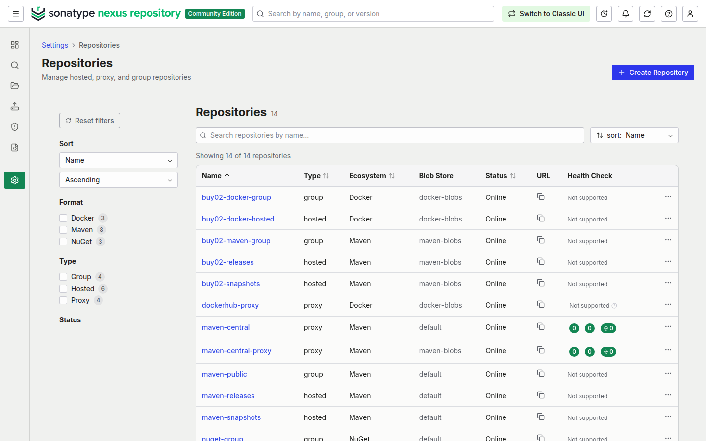
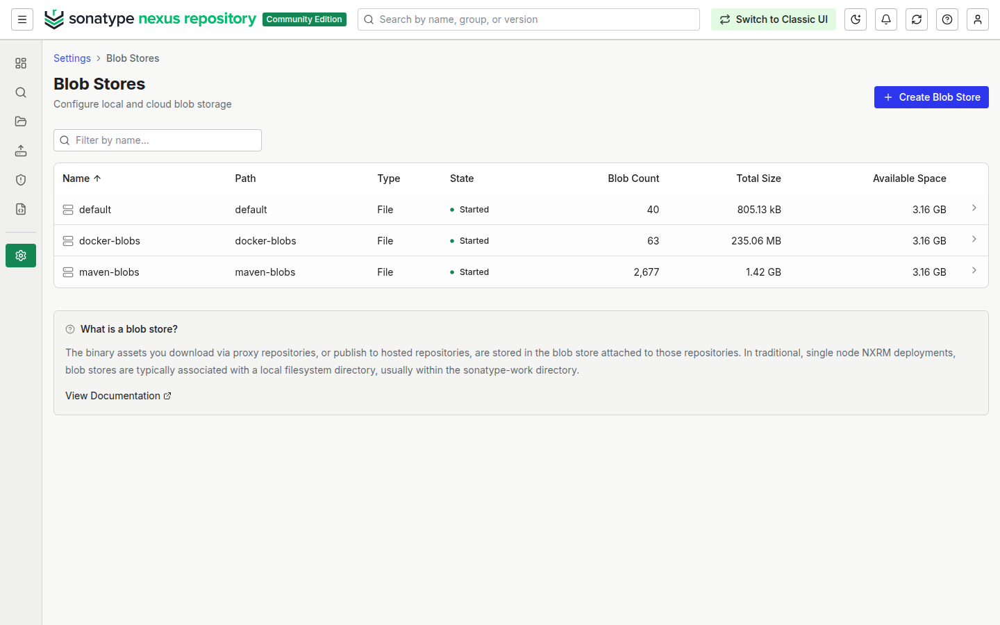

## 3. Maven: dependencies and publishing

`nexus/maven/settings.xml` mirrors **every** repository (`<mirrorOf>*</mirrorOf>`) to
`buy02-maven-group`, so no download can bypass Nexus. Credentials come from the
environment. The root `pom.xml` is the parent of all services and declares where
`mvn deploy` uploads:

```xml
<distributionManagement>
  <repository>         <id>nexus-releases</id>  <url>${nexus.url}/repository/buy02-releases/</url>  </repository>
  <snapshotRepository> <id>nexus-snapshots</id> <url>${nexus.url}/repository/buy02-snapshots/</url> </snapshotRepository>
</distributionManagement>
```

```bash
export NEXUS_URL=http://localhost:8081 NEXUS_USERNAME=ci-jenkins NEXUS_PASSWORD=...
mvn -s nexus/maven/settings.xml clean deploy
```

Proof that dependencies come from Nexus only. The build below starts from an empty
local repository:

```text
$ mvn -s nexus/maven/settings.xml -Dmaven.repo.local=/tmp/m2-empty clean package -DskipTests
$ grep -oE "Downloaded from [a-z-]+: https?://[^/]+" build.log | sort | uniq -c
    969 Downloaded from nexus: http://localhost:8081
[INFO] BUILD SUCCESS
```

Every file is now cached in `maven-central-proxy`, so the next build on any machine
is served by Nexus without going to the internet:

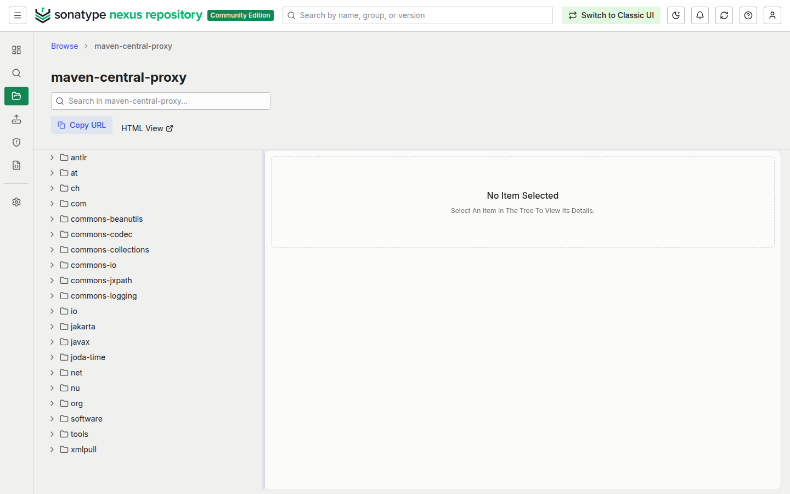

Deploying the snapshot uploads the parent pom and the six service jars:

```text
Uploaded to nexus-snapshots: http://localhost:8081/repository/buy02-snapshots/com/buy02/order-service/1.0.0-SNAPSHOT/order-service-1.0.0-20261110.221331-1.jar
```

## 4. Versioning, rollback and traceability

| | `1.0.0-SNAPSHOT` | `1.0.0` |
| --- | --- | --- |
| Repository | `buy02-snapshots` | `buy02-releases` |
| Redeploy | allowed: stored as `1.0.0-<timestamp>-<n>` | refused with **409 Conflict** |
| Use | every CI build | tagged, deployable releases |

All modules share one version, set in the root pom. A release is cut with:

```bash
nexus/release.sh 1.0.0          # tag v1.0.0, deploy 1.0.0, move main to 1.0.1-SNAPSHOT
git push origin main v1.0.0
```

Two builds of the same snapshot version kept side by side:

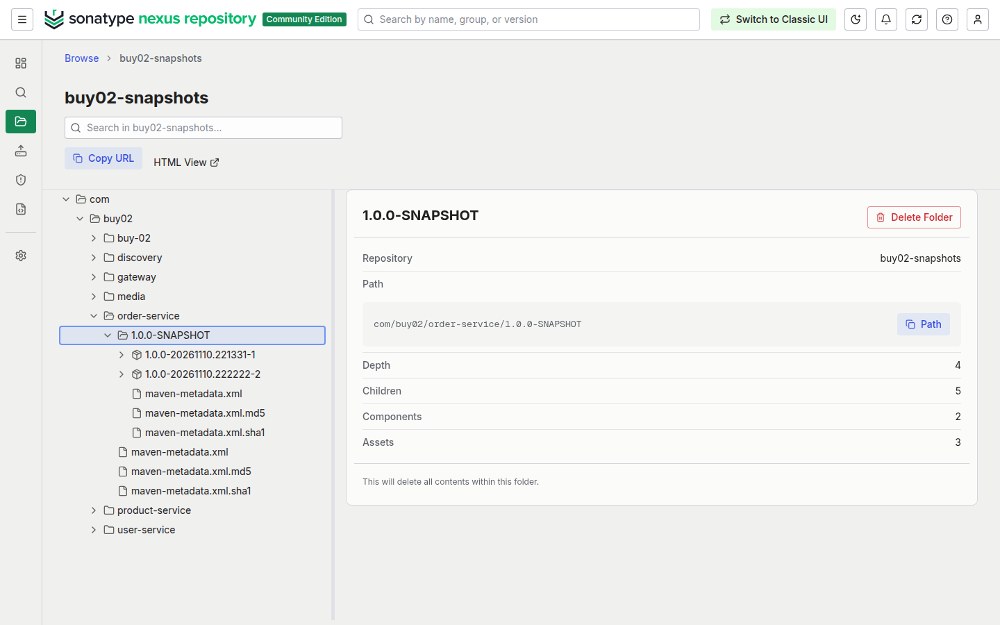

Every jar records its version and commit, and Spring Boot Actuator shows both at
`/actuator/info`:

```text
$ unzip -p order-service-1.0.0-SNAPSHOT.jar BOOT-INF/classes/git.properties META-INF/build-info.properties
git.commit.id.abbrev=cf410d1
build.version=1.0.0-SNAPSHOT
```

- **Rollback:** releases are immutable, so redeploying an earlier version gives exactly
  the same bytes:
  `mvn -s nexus/maven/settings.xml dependency:copy -Dartifact=com.buy02:order-service:1.0.0 -DoutputDirectory=.`
  or `docker run localhost:8083/buy02/order-service:1.0.0`.
- **Traceability:** artifact → `git.properties` → commit; tag `v1.0.0` → commit → artifact `1.0.0`.

## 5. Docker images

The Dockerfiles take their base-image registry as a build argument
(`ARG BASE_REGISTRY=docker.io/library`), so base images can be pulled through the Nexus
Docker Hub proxy. The publish script builds, tags and pushes:

```bash
mvn -s nexus/maven/settings.xml package -DskipTests
nexus/docker-publish.sh order-service          # or no argument for all services
```

```text
FROM localhost:8083/eclipse-temurin:17-jre-alpine        # base image via Nexus
pushed localhost:8082/buy02/order-service:1.0.0-SNAPSHOT (2a82770)
```

Images are tagged with the Maven version and the commit; `latest` only moves on releases.
Retrieval:

```bash
docker login localhost:8083 -u developer
docker pull localhost:8083/buy02/order-service:1.0.0-SNAPSHOT
```

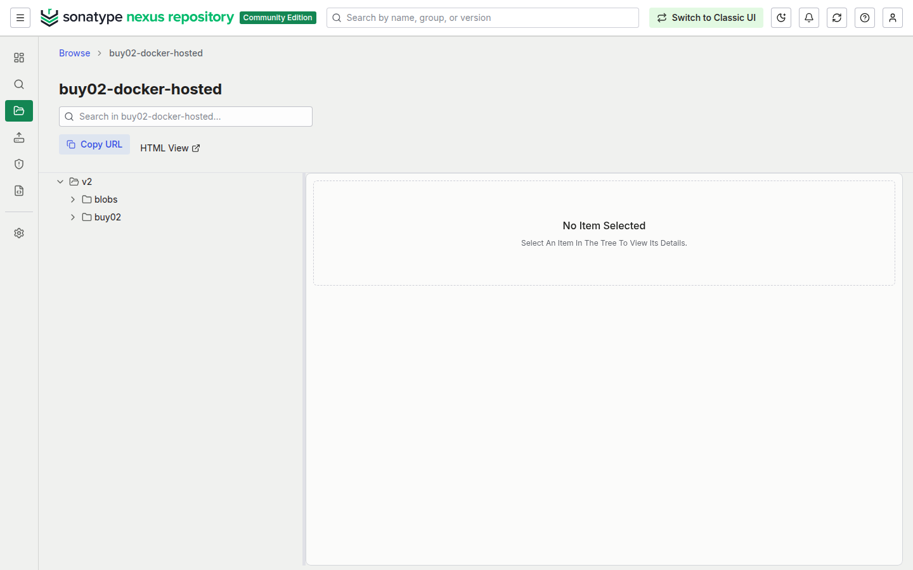
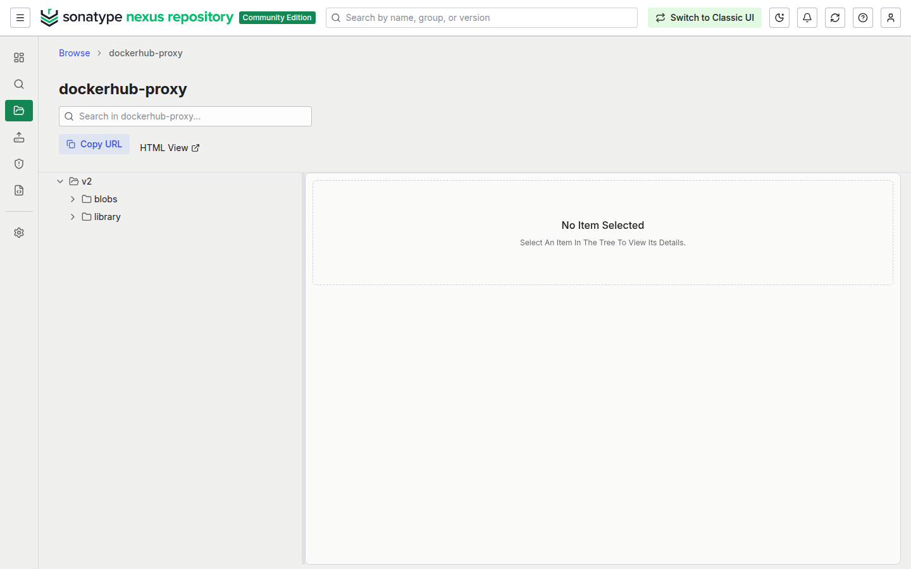

## 6. Continuous integration

The Jenkins pipeline (`Jenkinsfile`) runs on every push (GitHub webhook) and:

1. logs in to the Nexus Docker connectors as `ci-jenkins`;
2. runs the tests, builds the jars and passes the SonarQube gates, with every Maven call,
   including the Maven Wrapper download of Maven itself, going through `buy02-maven-group`;
3. builds the images from base images pulled through `buy02-docker-group`;
4. **Publish Maven Artifacts to Nexus**: `./mvnw deploy` publishes the parent pom and the
   jars. Snapshots go to `buy02-snapshots`, release versions to `buy02-releases`;
5. **Push Docker Images to Nexus**: pushes the 7 images tagged `<version>`, `<commit>` and
   `build-<n>`;
6. deploys to staging (unchanged) and logs out of Nexus.

Setup on the Jenkins lab (start Nexus first; it creates `nexus-network`):

```bash
printf '%s' "$NEXUS_CI_PASSWORD" > jenkins-lab/jenkins-secrets/nexus-ci-password
docker compose -f nexus/compose.yml up -d
scripts/run-jenkins-host.sh          # or: docker compose -f jenkins-lab/compose.yml up -d
```

The secret becomes the Jenkins credential `nexus-ci` (masked in logs). The host-Docker
profile pushes to `localhost:8082/8083`; the Docker-in-Docker profile pushes to
`nexus:8082/8083`, which its daemon trusts as insecure registries.

## 7. Security and access control

```bash
NEXUS_ADMIN_PASSWORD=... NEXUS_CI_PASSWORD=... NEXUS_DEV_PASSWORD=... \
NEXUS_RM_PASSWORD=... NEXUS_ORDER_PASSWORD=... nexus/security.sh
```

| User | Role | Can do |
| --- | --- | --- |
| `ci-jenkins` | `buy02-ci-deployer` | read; publish snapshots, releases and images; **no delete** |
| `developer` | `buy02-developer` | read Maven artifacts and pull images through the groups only |
| `release-manager` | `buy02-release-manager` | everything above plus deleting versions |
| `order-team` | `buy02-order-team` | read **only** `com/buy02/order-service` (content selector) |

Anonymous access is disabled, and no account except `admin` has administrator rights.
Measured results:

```text
anonymous   read group                401
developer   read group                200
developer   upload snapshot           403
ci-jenkins  upload snapshot           201
ci-jenkins  delete                    403
rel-manager delete                    204
order-team  read order-service        200
order-team  read media                403
developer   docker push               403 Forbidden
```

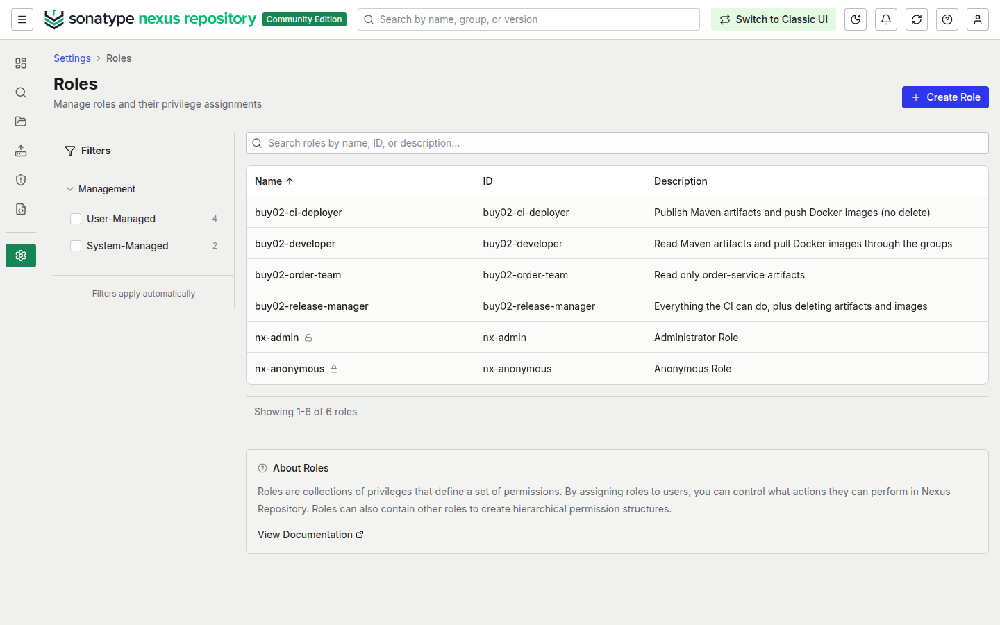
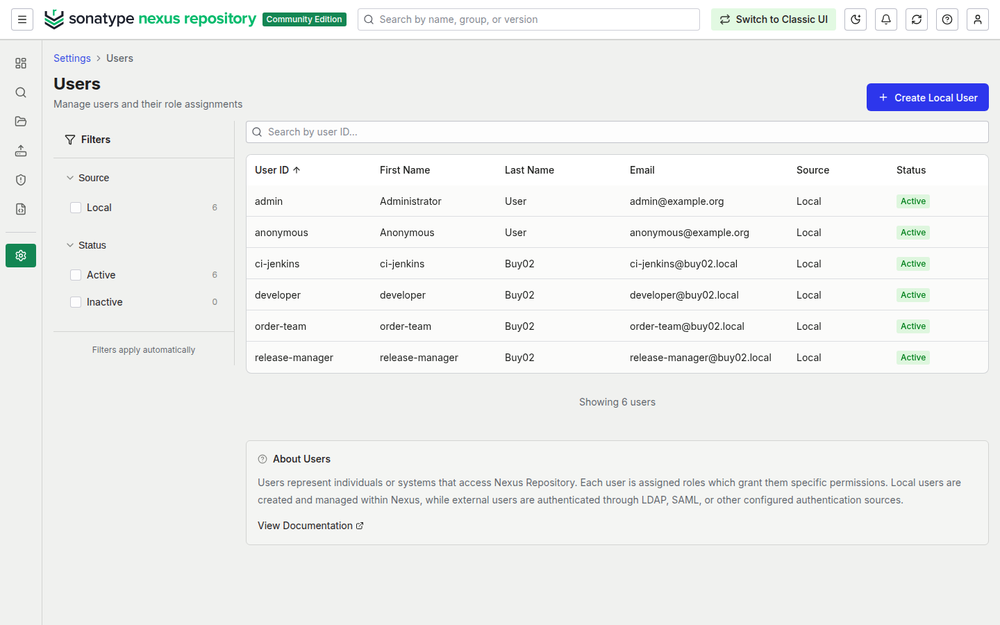
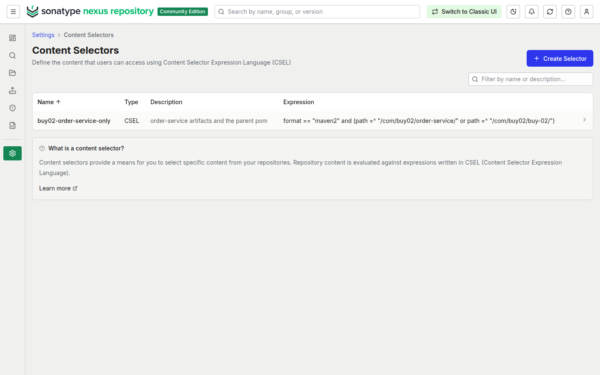
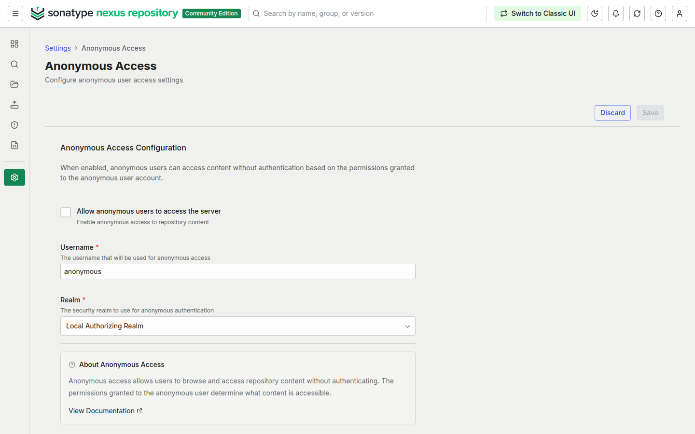
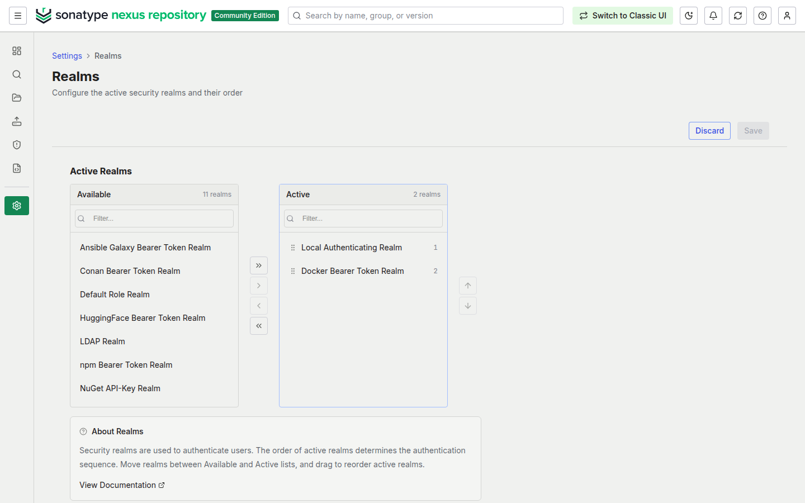

## Java version

The assignment asks for Java 11. Buy02 is built on Spring Boot 4.1, which requires
Java 17 or later, so the services target Java 17 (`<java.version>17</java.version>`) and
run on the `eclipse-temurin:17-jre` images. Downgrading to Java 11 would mean moving
back to Spring Boot 2.7, which is out of support. Maven 3.9.16 (pinned by the wrapper)
supports both.
